# 赛道罗盘 TrackCompass 产品使用手册

| 项目 | 内容 |
| --- | --- |
| 版本 | **V2.0** |
| 日期 | 2026-09-18 |
| 面向对象 | 创始人/CEO、战略部、产品负责人、投资部、领域专家、系统管理员 |
| 访问地址 | 本机 `http://127.0.0.1:8020/` · 局域网 `http://<本机IP>:8020/`（启动日志会打印实际地址） |
| API 文档 | `http://127.0.0.1:8020/docs`（Swagger） · `/redoc` |
| 配图来源 | 全部为**真实界面截图**，由 `node scripts/shoot_manual.mjs` 批量生成，可随时重跑刷新 |

> **本手册怎么用**
>
> - 第一次接触：看 **§0 三分钟上手**，按顺序点一遍就有完整结果。
> - 已经在用：**§5 常见问题**按「你看到的现象」组织，直接查症状。
> - 要判断「这个数据是怎么来的」：**§7 算法与口径速查**。
> - 文档体系：本手册=**怎么用**；`功能状态总表.md`=**做了什么**；`研发计划.md`=**排期**；`遗留项台账.md`=**已知问题**。

---

## 0. 三分钟上手

打开系统后，按这五步走就能拿到一份可用的决策报告（全部为真实大模型推理）：

| 步 | 在哪 | 做什么 | 耗时 | 产物 |
| --- | --- | --- | --- |
| 1 | 能力画像 | 填公司名称、技术栈、专利，点「保存并重新生成」 | 秒级 | 能力向量 + 能力雷达图 + 推荐赛道 |
| 2 | 趋势雷达 | 点「重新扫描」 | < 1 秒 | 一批带证据链的趋势 |
| 3 | 趋势雷达 | 挑一条顺风趋势 →「加入机会池」 | 秒级 | 一张机会卡片 |
| 4 | 赛道评分 | 选中该卡片 →「重跑七 Agent 分析」 | **约 1–2 分钟** | 七维评分 + 风险预警 + 冲突点 |
| 5 | 决策报告 | 选卡片与模板 →「生成报告」 | 秒级 | 9 段结构报告，可导出 PPT/Word |

> **第 4 步是全站最贵的操作**（真实模型下约 1–2 分钟）。**不必守着页面等** ——
> 点完可以直接去别的页面，跑完会在右上角弹全局通知，回到该页结果自动出现。见 §3.1。

---

## 1. 启动与登录

### 1.1 启动

**单端口模式（推荐）** —— 一个进程、一个端口同时提供界面与接口：

```bash
cd D:/01code/business/trackcompass
bash scripts/start-all.sh          # 自动：装依赖 → 构建前端 → 初始化数据 → 启动

# 已有构建产物时跳过后端前置步骤：
SKIP_BUILD=1 bash scripts/start-all.sh
```

启动后浏览器打开 **http://127.0.0.1:8020/** 即可，无需再单独开前端服务。

**局域网访问（默认已开启）**

服务默认绑定 `0.0.0.0`，同网段的同事用 `http://<本机IP>:8020/` 打开即可，
**启动日志里会直接打印可用的局域网地址**。单独查询本机 IP：

```bash
"C:/Users/PC/.workbuddy/binaries/python/envs/trackcompass/Scripts/python.exe" scripts/lan_ip.py
```

| 需求 | 做法 |
| --- | --- |
| 局域网可访问（默认） | `bash scripts/start-all.sh` |
| **仅本机**可访问 | `HOST=127.0.0.1 bash scripts/start-all.sh`（CMD：先 `set HOST=127.0.0.1`） |
| 换端口 | `PORT=8030 bash scripts/start-all.sh` |
| 同网段打不开 | 放行入站端口（管理员执行一次）：<br>`netsh advfirewall firewall add rule name="TrackCompass 8020" dir=in action=allow protocol=TCP localport=8020` |

> ⚠️ 三点必读：
> 1. 开放局域网后**同网段任何人都能登录**（演示账号是公开的）。仅在受信任内网使用；对外演示前先改密码。
> 2. `127.0.0.1:8020` 与 `192.168.x.x:8020` 是**两个不同的站点来源**，登录态各存各的 ——
>    从本机地址切到局域网地址需要**重新登录一次**，属正常现象。
> 3. 局域网自检：`python scripts/check_lan_access.py`（本机与局域网两个来源各 6 项）。
>    本机 curl 自己的局域网 IP 可能绕开入站防火墙，**跨机验证请用另一台机器**。

**前端开发模式** —— 只在改前端代码并需要热更新时用：

```bash
scripts\start-backend.cmd      # 后端 → http://127.0.0.1:8020
scripts\start-frontend.cmd     # 前端 → http://127.0.0.1:5180（已代理 /api → 8020）
```

**纯命令行**：

```bash
cd D:/01code/business/trackcompass/frontend && npm run build        # 构建前端（一次即可）
cd D:/01code/business/trackcompass/backend
"C:/Users/PC/.workbuddy/binaries/python/envs/trackcompass/Scripts/python.exe" \
  -m uvicorn app.main:app --host 0.0.0.0 --port 8020
```

> ⚠️ **改动任何后端 Python 代码后必须重启进程**（未开 `--reload`，改文件不会生效）。
> 判断是否真的重启过：进程启动时间戳应晚于被改文件的修改时间。

### 1.2 登录

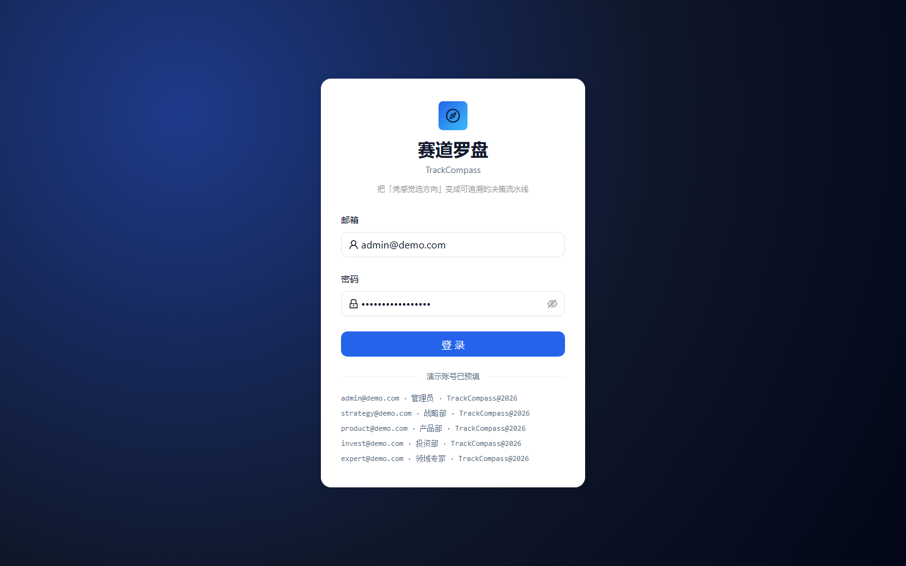

演示账号已预填在页面上，直接点「登 录」：

| 邮箱 | 角色 | 可做的事 |
| --- | --- | --- |
| admin@demo.com | 管理员 | 全部权限，含用户与审计管理 |
| strategy@demo.com | 战略部 | 查看机会、编辑评分、生成报告、管理实验与预警 |
| product@demo.com | 产品部 | 查看机会、管理验证实验 |
| invest@demo.com | 投资部 | 查看机会、生成报告 |
| expert@demo.com | 领域专家 | 查看机会、校准评分 |

统一密码：`TrackCompass@2026`

登录成功后跳到 **工作台**。若登录没有跳转，请确认后端已启动 —— 这类问题见 §5。

### 1.3 首次使用的三件事

| 事项 | 位置 | 说明 |
| --- | --- | --- |
| 确认分析引擎 | 工作台 → **分析引擎状态** | 显示当前用的是真实大模型还是规则引擎（见 §7.4） |
| 采集一批信号 | 信号库 / 设置 → **采集 / 干跑** | 趋势由信号聚合而来，信号为空则趋势为空 |
| 建一家公司画像 | 能力画像 | 评分、报告都以「当前公司」为主体 |

---

## 2. 核心工作流（推荐顺序）

```
① 建立能力画像  →  ② 趋势雷达扫描  →  ③ 加入机会池
                                        ↓
④ 七 Agent 分析  →  ⑤ 赛道评分  →  ⑥ 需求探针验证
                                        ↓
⑦ 验证实验  →  ⑧ 决策报告  →  ⑨ 监控复盘与模型校准
```

| 步 | 页面 | 产物 | 关键说明 |
| --- | --- | --- | --- |
| ① | 能力画像 | 1536 维能力向量、能力雷达、推荐赛道 | **不建画像也能用**，但匹配度评估会失真 |
| ② | 趋势雷达 | 趋势卡（含证据链与评分因子） | 趋势只由**外部信号**决定，画像不参与生成 |
| ③ | 趋势雷达 | 机会卡片 | 也可在机会图谱的「空白点」直接创建 |
| ④ | 赛道评分 | 七维评分、风险预警、冲突点 | **全站最贵**：真实模型 1–2 分钟 |
| ⑤ | 赛道评分 | 权重调整后的排序 | 权重改动会重排所有机会卡片 |
| ⑥ | 需求探针 | 痛点聚类、需求强度、建议验证实验 | 结果可一键转成⑦的实验假设 |
| ⑦ | 验证实验 | 指标达成率、结论 | 结论可**回写**赛道评分 |
| ⑧ | 决策报告 | 9 段报告，可导出 PPT/Word | 报告正文可在线看（§4.9） |
| ⑨ | 监控复盘 | 预警、复盘记录、校准建议 | 校准建议可一键应用到评分卡 |

---

## 3. 通用交互约定

这一节适用于**所有页面**，理解它就不容易误会系统行为。

### 3.1 任务在后台跑，不必守着页面

所有「点一下、要等几秒到几十秒」的操作（趋势扫描、需求探针、七 Agent 分析、信号采集、
报告生成、索引重建……）都是**后台任务**：

| 现象 | 说明 |
| --- | --- |
| 点击后按钮进入 loading | 任务已提交，**但你不必留在这一页** |
| 顶栏出现 `N 个任务后台运行中` | 鼠标悬停可看是哪个页面、哪个任务 |
| 切到别的页面 | 任务**继续跑**，不会被中断 |
| 任务完成 | 右上角弹**全局通知**（带结果摘要），无论你当前在哪一页 |
| 回到发起页 | 结果**自动出现**，不需要重跑；页面顶部标明「上次分析 时间（条件）」 |
| 列表页正开着 | 别的页面发起的任务跑完，列表也会**自动刷新** |

几点设计取舍，提前说明以免误解：

- **同一件事不会跑两遍**：趋势扫描在「工作台 / 趋势雷达 / 能力画像」三处是同一个任务；
  采集在「信号库 / 设置」是同一个任务 —— 一处已在跑，另一处的按钮会同步显示进行中。
- **没有进度百分比**：后端是同步接口，不提供中间进度，只能显示「运行中」。
- **没有「取消」按钮**：中途取消会留下算了一半的数据，风险大于收益。
- **刷新页面会中断任务**：这时顶栏不再显示「运行中」，请在该页重新执行 ——
  系统的态度是**宁可让你知道要重跑，也不假装还在跑**。

### 3.2 离开页面再回来，现场会保留

切菜单会卸载页面组件，为不丢现场，以下状态**跨页面保留**：

| 页面 | 保留内容 |
| --- | --- |
| 需求探针 | 关键词、数据源、行业、**上次结果**、结果对应的条件快照 |
| 趋势雷达 | 筛选条件、能力画像 × 外部信号面板 |
| 赛道评分 | 选中的机会卡片、七 Agent 执行明细、本次分析依据、**权重草稿与预览** |
| 能力画像 | 选中的公司、**未保存的填写**、当前步骤 |

两条硬约定：

1. **凡保留的结果都标注「条件 + 时间」**（如 `上次分析 09-18 13:54（关键词 光学 · 数据源 8 个 · 行业 AI+制造）`）。
   条件改过但没重跑时会提示「检索条件已改动」—— 否则旧结果会被当成新条件的结论。
2. **换账号自动清空**：登出或令牌失效时，上述会话态一并清除，避免看到上个账号的结果。

> 能力画像的未保存内容会恢复，并给「**丢弃草稿**」一键还原成已保存版本。
> 右侧能力向量与推荐赛道**始终按已保存的画像渲染** —— 草稿没落库，不代表对外生效的数据。

### 3.3 出错时会发生什么

单个页面渲染出错**不会**再让整个系统变成空白页：

- 该页内容区显示 **「这块内容渲染出错了」+ 错误原文** + 三个出路（重试 / 回到工作台 / 刷新页面）；
- **左侧导航仍然可用**，可以直接切到别的页面继续工作；
- 同一时刻只有出错的页面受影响，其他功能不受牵连。

### 3.4 一切结论都可下钻

系统的原则是**每个数字都要能找到出处**：

- 机会卡片 → 分数 → 维度 → **证据条数** → 原始信号（信号库）；
- 报告每个小节都带**证据编号**；
- 趋势卡可展开完整证据链与评分因子；
- 赛道评分的「本次分析依据」会列出**用了哪些能力词、命中了哪几个**。

---

## 4. 逐页操作说明

### 4.1 P02 工作台

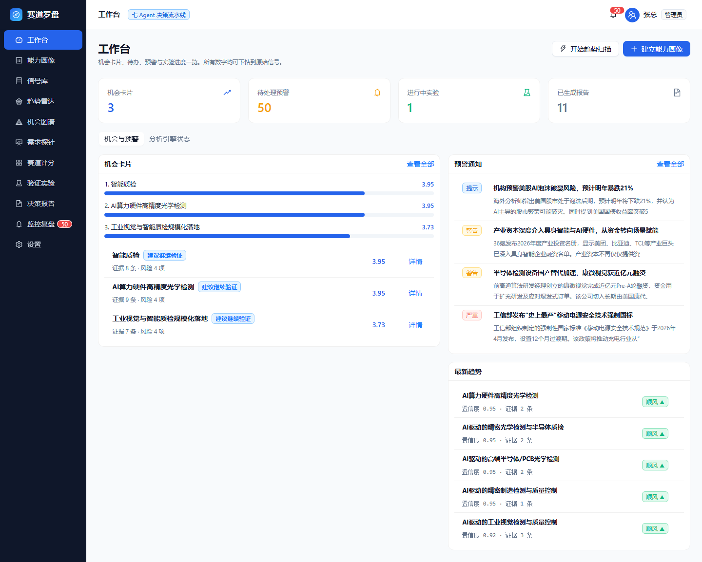

**定位**：每天的入口页，四类数字 + 两条行动线。

| 区域 | 内容 |
| --- | --- |
| 四个统计卡 | 机会卡片数、待处理预警、进行中实验、已生成报告 —— 点击即跳对应模块 |
| 右上两个动作 | **开始趋势扫描**（后台任务）· **建立能力画像** |
| 机会与预警 Tab | 左：机会排序条形图 + 机会列表（分数、结论、证据数、风险数）；右：预警通知 + 最新趋势 |
| 分析引擎状态 Tab | 七 Agent 四层编排图 + 运行时健康检查 |

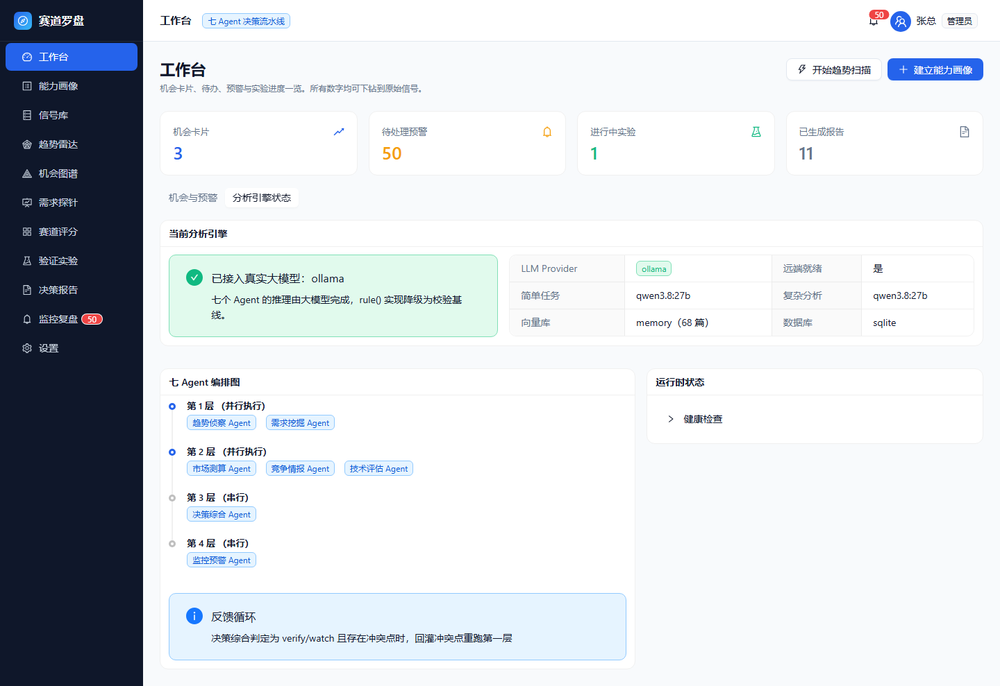

**七 Agent 编排**（第 1、2 层并行，第 3、4 层串行）：

```
第 1 层（并行）：趋势侦察 · 需求挖掘
第 2 层（并行）：市场测算 · 竞争情报 · 技术评估
第 3 层（串行）：决策综合
第 4 层（串行）：监控预警
反馈循环：决策综合判定 verify/watch 且存在冲突点时，回灌冲突点重跑第 1 层
```

> **「分析引擎状态」是判断当前跑的是谁的最快入口** ——
> 显示「已接入真实大模型」时，推理耗时会是规则引擎的数十倍，属正常。

### 4.2 P03 能力画像

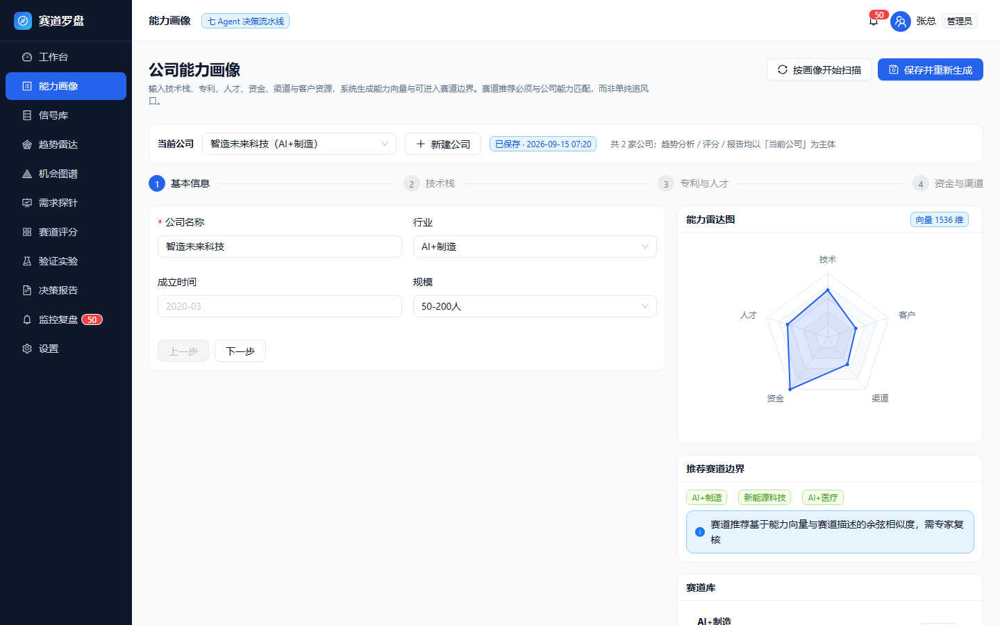

**定位**：告诉系统「我们是谁、能做什么」。**赛道推荐必须与公司能力匹配，而非单纯追风口。**

#### 多公司管理

页面顶部有 **「当前公司」** 选择器：

| 操作 | 效果 |
| --- | --- |
| 选一家已保存的公司 | 该公司画像全量回填到表单与右侧雷达/赛道面板 |
| 点 **新建公司** | 清空表单进入新建态；保存后创建**新的**一份档案 |
| 选一家公司后改内容并保存 | **更新该公司**，不会新建、不会覆盖其他公司 |
| 输入一个已存在的公司名并保存 | 视为**同一家公司**，执行更新，不会重复建档 |

> **分析主体规则**：趋势分析、赛道评分、决策报告都以 **「当前公司」** 为主体。
> 「当前公司」= **最近保存的那一份**，所以「切换公司 → 保存」即等于切换分析主体。

#### 分步填写（4 步）

1. **基本信息**：公司名称（必填）、行业、成立时间、规模
2. **技术栈**：标签输入（回车添加）、核心技术描述；可上传**纯文本**公司简介自动抽取标签
3. **专利与人才**：专利标签、算法/工程/产品/销售人数
4. **资金与渠道**：融资阶段、累计融资额、渠道、客户行业

点 **保存并重新生成** 后：

- 生成 **1536 维能力向量**；
- 右侧更新 **能力雷达图**（技术/人才/资金/渠道/客户，1–5 分）；
- 生成 **推荐赛道边界**（能力向量 × 赛道描述的余弦相似度，取 Top-3）。

> 说明：PDF / Word 二进制文件暂不支持直接解析，请粘贴文本或手工填写。
> 各步骤内容会随步骤切换隐藏（同一时刻只显示当前步骤），这是分步表单的预期行为；
> 点顶部 **Steps 步骤条** 或「上一步」即可回到该步。
> 顶部标签显示 **已保存 · 时间**，可据此确认界面数据是否已落库。

### 4.3 P12 信号库

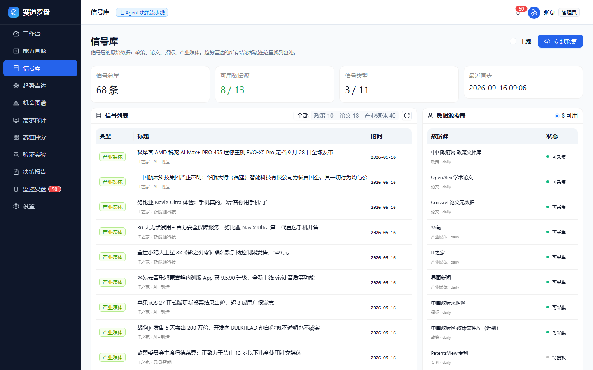

**定位**：信号层的原始数据 —— 政策、论文、招标、产业媒体。**趋势雷达的所有结论都能在这里找到出处。**

| 区域 | 内容 |
| --- | --- |
| 四个统计卡 | 信号总量、可用数据源、信号类型（x / 11）、最近同步 |
| 动作按钮 | **立即采集**（真实写库）· **干跑**勾选框（只抓取与清洗，**不写库**） |
| 信号列表 | 标题、类型、来源、行业、发布时间、关键词；点一行开**详情抽屉** |
| 数据源适配器表 | 每个源的连接状态、信号数、最后同步时间；不可用会给出原因 |

详情抽屉里可以看到信号的**完整字段**（类型 / 来源 / 行业 / 发布时间 / 关键词 / 正文），
并可通过「**查看原文**」跳到原始出处。

> **接入新数据源前建议先干跑** —— 干跑不写库，能先看清抓回来的内容质量。
> **「可达 ≠ 可用」**：某个源 HTTP 200 不代表内容能解析（曾出现 RSS 解析失败）。

### 4.4 P04 趋势雷达

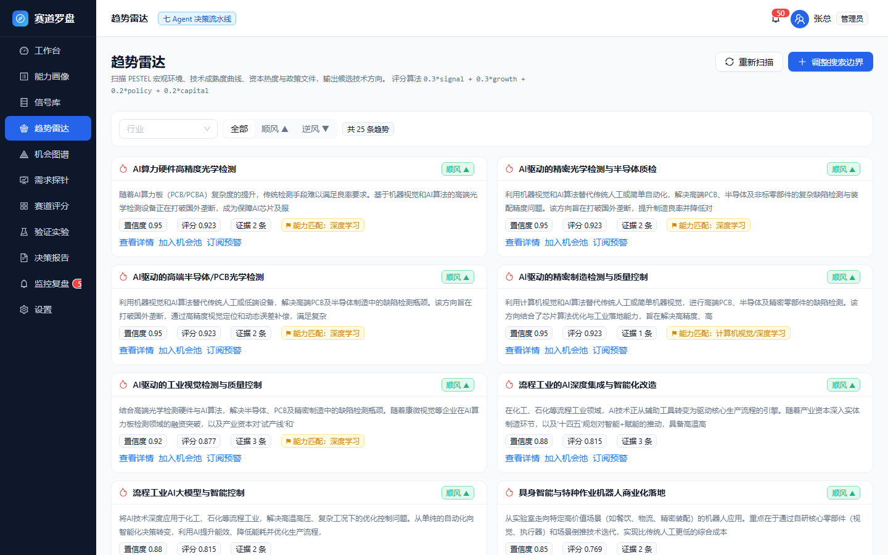

**定位**：从外部信号里识别「顺风 / 逆风」的赛道方向。

- 顶部筛选：**行业下拉** + 全部 / 顺风 / 逆风；右上 **重新扫描**、**按画像开始扫描**。
- 每张趋势卡显示：置信度、评分、证据条数、方向标记、订阅状态。
- 卡内三个动作：

| 动作 | 效果 |
| --- | --- |
| **查看详情** | 右侧抽屉展开完整证据链与评分因子 |
| **加入机会池** | 弹窗确认后生成机会卡片，并跳转赛道评分页 |
| **订阅 / 取消订阅** | 该趋势相关信号变化时出现在监控预警列表 |

趋势评分算法（技术文档 §4.2）：

```
0.3 × 信号量 + 0.3 × 增速 + 0.2 × 政策支持 + 0.2 × 资本热度
```

> **一条容易搞混的规则**：趋势**只由外部信号决定**（信号里的关键词决定「有哪些趋势」），
> 公司能力画像**不参与生成与打分**，只用于在扫描结果里标注「能力命中 / 情报空白」。
> 所以「雷达里没有某个方向」= **外部信号里没有它**，不是画像的问题。

### 4.5 P05 机会图谱

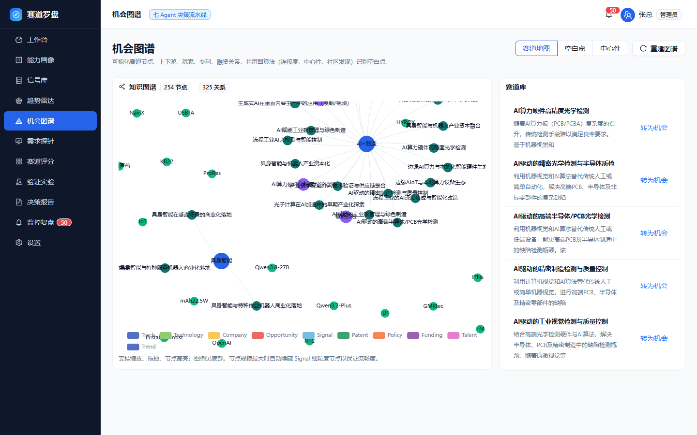

**定位**：把赛道、技术、公司、机会、信号、专利、政策、融资、人才的关系画成一张图。

右上角三视图切换：

| 视图 | 内容 |
| --- | --- |
| **赛道地图** | 力导向图，节点按类型着色；支持缩放、拖拽、高亮 |
| **空白点** | 用图算法找连接度低的赛道节点（degree < 5），可直接「转为机会」 |
| **中心性** | 度中心性排名 + 社区发现分簇，识别关键卡位点 |

节点超过 120 个时自动隐藏细粒度 Signal 节点以保证流畅度。

> 「空白点 → 转为机会」时会校验该赛道是否已有对应趋势；没有会提示先去趋势雷达扫描。

### 4.6 P06 需求探针

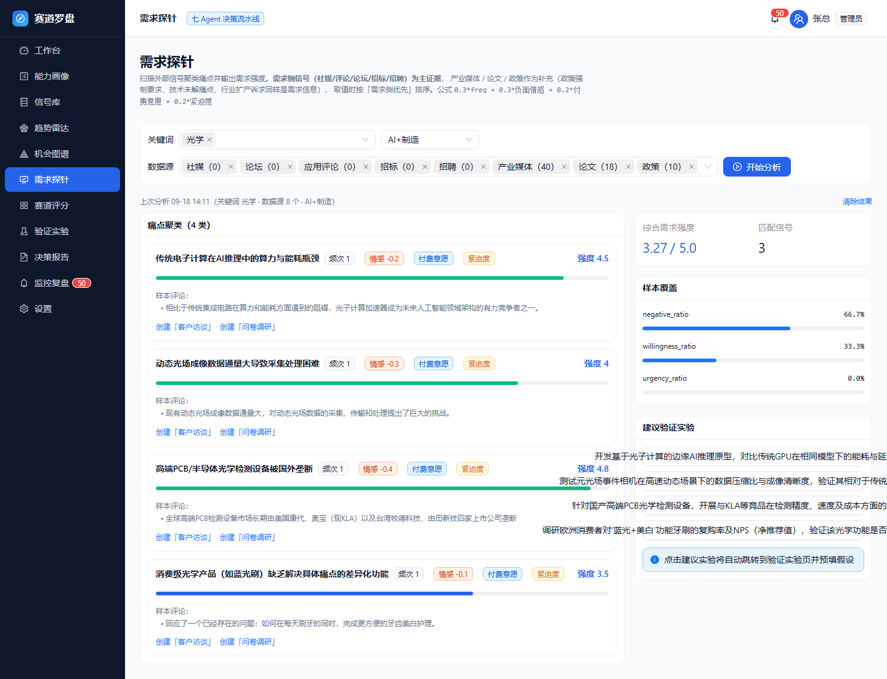

**定位**：验证「这个方向到底有没有真实需求」，并给出可执行的验证方案。

操作步骤：

1. 输入**关键词**（回车添加，如「质检」「漏检」「部署成本」）
2. 选择**数据源** —— 选项分两组，括号内是信号库里的**实际存量**：
   - **需求侧信号（用户发声，主证据）**：社媒 / 论坛 / 应用评论 / 招标 / 招聘
   - **补充信号（同样承载需求信息）**：产业媒体 / 论文 / 政策
3. 可选**行业**过滤
4. 点 **开始分析**，进度条显示「检索 → 聚类 → 计算强度」

结果区：

- **痛点聚类卡片**：频次、情感、付费意愿、紧迫度、需求强度；可展开样本评论
- **综合需求强度**（1–5 分）与匹配信号数
- **样本覆盖**：负面占比、付费信号占比、紧迫度占比
- **建议验证实验**：点任一实验跳转到验证实验页并**自动预填假设**

需求强度算法（技术文档 §4.4）：

```
0.3 × 频次 + 0.3 × 负面情感占比 + 0.2 × 付费意愿 + 0.2 × 紧迫度
```

**口径说明**：需求强度不只统计「用户直接发声」，政策（强制要求 / 补贴导向）、
论文（未解的技术痛点）、产业媒体（行业诉求与扩产意图）同样计入 ——
因为需求侧五类信号在真实库里常常一条都没有，只按设计口径会永远出 0 条。
取数时**需求侧优先**排序，prompt 中如实标注证据类型，可信度交模型判断。
两侧证据强度并不等同：需求侧有直接的付费意愿与负面情绪，补充信号只体现意向。

> **看到 0 条怎么办**：先看数据源选项括号里的**存量**。
> 若所选源存量都是 0，说明库里没有这类数据（去信号库采集）；
> 若有存量却仍 0 条，改用更贴近库内内容的词（如「光学」而不是「质检」）。
> **默认数据源 = 需求侧五类 ∪ 库内已有类型**，手动改过后系统不再覆盖你的选择。

结果跨页保留：切到别的菜单再回来，条件与结果都在，顶部标明 `上次分析 时间（条件）`；
条件改了但没重跑会提示「检索条件已改动」；点「清除结果」回到空态。

### 4.7 P07 赛道评分

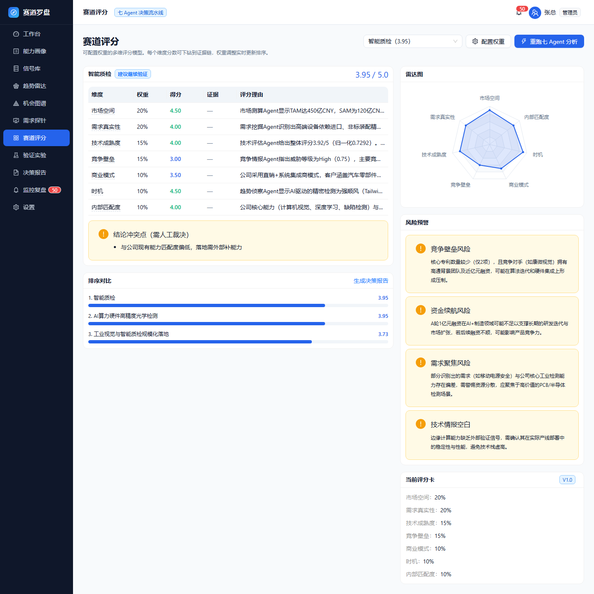

**定位**：可配置权重的多维评分模型，**每个维度都能下钻到证据链**。

- 右上：**选择机会卡片**下拉（显示标题与当前分数）· **配置权重** · **重跑七 Agent 分析**。
- 若该机会尚未分析，会出现「立即分析」引导。
- **维度表**：7 个维度显示权重、得分、证据数、评分理由（悬停看完整理由）。
- **结论冲突点**：黄色块显示需人工裁决的矛盾（如「与公司现有能力匹配度偏低，落地需外部补能力」）。
- **排序对比**：所有机会按分数降序，点击可切换查看；右上可跳到生成决策报告。
- 右侧：**雷达图** · **风险预警** · **当前评分卡**版本与权重。

**七维与默认权重**：

| 维度 | 默认权重 | 判读要点 |
| --- | --- | --- |
| 市场空间 | 20% | TAM / SAM / SOM 测算结果 |
| 需求真实性 | 20% | 痛点频次、付费意愿、紧迫度 |
| 技术成熟度 | 15% | 技术评估 Agent 的综合判定 |
| 竞争壁垒 | 15% | 竞争威胁等级与大厂入场风险 |
| 商业模式 | 10% | 单位经济性与可复制性 |
| 时机 | 10% | 政策与产业周期窗口 |
| 内部匹配度 | 10% | 与公司能力画像的契合度 |

**风险预警**分两种来源，会一并列出：

- **阈值型**（确定性）：某维度低于阈值即触发，详情里写明「某某得分 2.80 < 阈值 3.00」；
- **模型识别型**：真实大模型读证据链后给出的业务风险，如「交付能力瓶颈：公司规模难以支撑并行部署」。

**调整权重**：滑块调整后下方实时显示合计百分比，**必须合计 100%**；
可先点 **预览排序影响** 在不保存的情况下看新评分；确认后 **保存并重算排序**。

> 权重草稿与预览都**按机会卡片分别存**：换一张卡片看到的是那张自己的草稿，不会串。

### 4.8 P08 验证实验

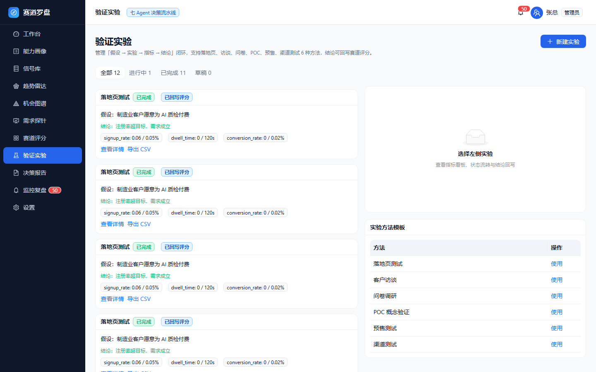

**定位**：管理「假设 → 实验 → 指标 → 结论」的闭环，结论可回写赛道评分。

- 右上 **新建实验**：选择方法（6 种）、关联机会卡片（用于回写）、填写核心假设。
- 列表按状态分组：全部 / 进行中 / 已完成 / 草稿，支持搜索。

**6 种方法**：落地页测试、客户访谈、问卷调研、POC 概念验证、预售测试、渠道测试。

**状态机**（只显示当前状态允许的转换）：

| 当前状态 | 可转到 |
| --- | --- |
| 草稿 | 进行中 · 已取消 |
| 进行中 | 已完成 · 已取消 |
| 已完成 | 已归档 · 进行中（回退重跑） |
| 已取消 | 草稿（重新起草） |
| 已归档 | —（终态） |

实验详情里可以：

| 功能 | 说明 |
| --- | --- |
| 指标看板 | 每项指标的当前值 vs 目标值 + 达成率进度条 |
| 状态流转 | 只显示状态机允许的转换按钮 |
| **回写赛道评分** | 把实验达成率折算到「需求真实性」维度，并更新机会状态 |
| **导出数据** | 下载 CSV（带 BOM，Excel 直接打开不乱码） |

### 4.9 P09 决策报告

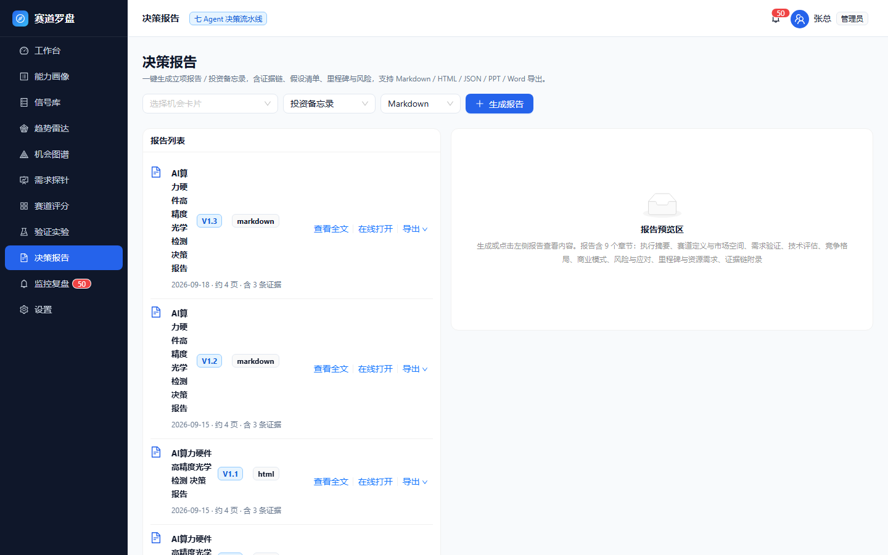

**定位**：把分析结论落成可对外分发的文档。

操作：选择机会卡片（仅列出**已完成分析**的）、模板、格式 → 点 **生成报告**。

**三种模板**：

| 模板 | 适用场景 |
| --- | --- |
| 投资备忘录 | 面向投资决策委员会，强调回报、风险与退出路径 |
| 立项报告 | 面向公司管理层，强调可行性、资源与里程碑 |
| 趋势简报 | 面向战略部周会，短平快，突出信号与判断 |

**固定 9 段结构**：执行摘要 → 赛道定义与市场空间 → 需求验证 → 技术评估 → 竞争格局 →
商业模式 → 风险与应对 → 里程碑与资源需求 → 证据链附录。

**怎么看报告**（左侧「报告列表」每条有三个动作）：

| 动作 | 说明 |
| --- | --- |
| **查看全文** | 在右侧内嵌阅读，按 9 段渲染（表格、要点、证据编号都在）—— **历史报告同样能看** |
| **在线打开** | 新标签页打开排版版（HTML）。若该报告还没导出过 HTML，会先自动导出一份再打开 |
| **导出 ▾** | 导出 HTML / Markdown / PPT / Word / JSON；导 HTML 会顺手在新标签页打开 |

> 报告正文存在库里，列表接口只回元信息 —— 所以「查看全文」是**单独拉一次正文**，
> 点开时有短暂 loading 属正常。右侧预览区也支持直接导出 PPT / Word。

### 4.10 P10 监控复盘

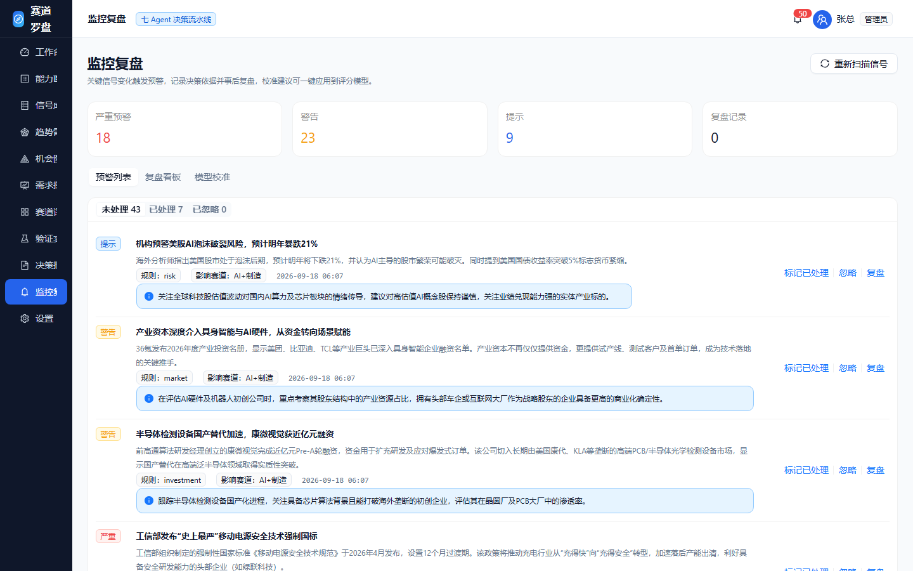

**定位**：让决策闭环 —— 预警、复盘、校准。

三个 Tab：

1. **预警列表**：按未处理 / 已处理 / 已忽略分组。每条预警显示级别（严重 / 警告 / 提示）、
   规则名、影响赛道、处置建议，可「标记已处理 / 忽略 / 复盘」。
2. **复盘看板**：记录决策依据、实际结果、复盘结论，自动生成校准建议，可一键「应用校准」。
3. **模型校准**：展示校准建议表（维度 / 权重变化 / 理由）、当前评分卡与校准后的对比、
   历史版本对比（如 V1.0 → V1.1 的权重变化）。

**预警规则**（技术文档 §4.8）：大厂入场（融资金额 ≥ 1 亿且为头部主体）、政策利好、
技术突破、需求激增、招标放量、监管收紧。

### 4.11 P11 设置

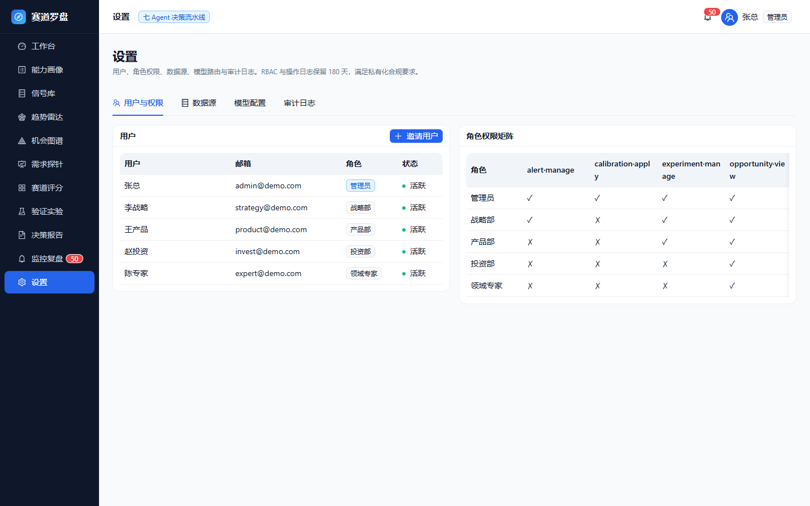

| Tab | 内容 |
| --- | --- |
| **用户与权限** | 用户列表（角色、状态）+ 角色权限矩阵 |
| **数据源** | 各数据源的连接状态、信号数、最后同步时间；可**重建向量索引与知识图谱** |
| **模型配置** | LLM 三档路由（简单 / 复杂 / 私有化）、缓存有效期、Embedding / 向量库 / 图谱 / 数据库后端 |
| **审计日志** | 操作日志（时间 / 动作 / 对象 / 详情），保留 180 天 |

---

## 5. 常见问题（按症状查）

### 5.1 打开与登录

**Q：打开 `http://127.0.0.1:8020/` 看到的是 JSON，不是界面**
前端未构建。执行 `scripts\build-frontend.cmd` 或 `cd frontend && npm run build`，然后重启后端。

**Q：点了登录没反应 / 停在登录页**
先确认后端在跑：`curl http://127.0.0.1:8020/api/v1/health`。
若接口正常但仍跳不过去，硬刷新一次（Ctrl+F5）清掉旧前端缓存。
**注意**：`127.0.0.1:8020` 与 `192.168.x.x:8020` 是两个来源，切换地址要重新登录。

**Q：页面提示「无法连接后端服务」**
后端未启动或端口被占。若 8020 被占用，换端口启动并同步修改 `frontend/vite.config.ts` 的 proxy target。

**Q：局域网里同事打不开**
① 服务是否绑在 `0.0.0.0`（启动日志的监听地址）；② 防火墙是否放行入站 8020；③ 是否同一网段。

### 5.2 数据与链路

**Q：趋势雷达是空的**
趋势由信号聚合而来 —— 先看信号库的信号总量是否为 0。为 0 则先去信号库采集，
再点「重新扫描」。

**Q：趋势雷达里没有我关心的方向**
**先查外部信号里有没有**（信号库按关键词搜）。趋势只由信号决定，
公司画像不参与趋势生成，所以「画像里有这个能力、雷达里却没有」是正常的信息空白。

**Q：赛道评分显示「尚未选择机会」**
从右上角下拉选一张机会卡片。若列表为空，先去趋势雷达「加入机会池」或机会图谱「空白点 → 转为机会」。

**Q：赛道评分显示「该机会尚未分析」**
机会卡片需要先跑七 Agent 分析才有评分。点右上角 **重跑七 Agent 分析**（真实模型约 1–2 分钟，可切页等通知）。

**Q：需求探针结果 0 条**
见 §4.6 的提示：先看数据源选项括号里的**存量**。所选项存量都是 0 ⇒ 库里没有这类数据；
有存量但 0 条 ⇒ 换个贴近库内内容的词。

**Q：模型校准没有建议**
校准建议只在特定条件触发（需求强度 ≥ 4.0 且大厂威胁 ≥ 0.6，或技术就绪度 ≤ 3.0）。未触发属正常。

### 5.3 操作与结果

**Q：点完按钮切走了，结果还在吗**
在。任务在后台跑，完成后弹全局通知，回到该页结果自动出现。见 §3.1。

**Q：刷新了页面，任务还在跑吗**
不在。刷新会中断在飞请求，顶栏不再显示「运行中」—— 请在该页重新执行。

**Q：为什么按钮没有进度条 / 取消键**
后端是同步接口，没有中间进度可取；中途取消会留下算了一半的数据，故不提供。

**Q：权重改了但排序没变**
要合计 **100%** 才会生效。可以先「预览排序影响」看效果，再「保存并重算排序」。

**Q：某个页面一块区域显示「这块内容渲染出错了」**
这是**局部**渲染错误被兜住了：不影响其他页面，左侧导航仍可用。
点「重试」通常即可恢复；反复出现请把错误原文连同页面路径一起反馈（用于定位数据形态问题）。

### 5.4 报告与导出

**Q：导出 PPT / Word 失败或拿到的是 Markdown**
缺可选依赖。安装后重启后端：

```bash
"C:/Users/PC/.workbuddy/binaries/python/envs/trackcompass/Scripts/python.exe" \
  -m pip install python-pptx python-docx -i https://pypi.tuna.tsinghua.edu.cn/simple
```

> 两个包名容易写错：Word 用的是 **python-docx**（import 名 `docx`），不是 `docxtpl`。

**Q：历史报告点「查看」是空的**
现在不会了 —— 「查看全文」会单独拉一次正文。若仍为空，刷新页面重试。

**Q：报告里没有风险条目**
风险分两类（阈值型 + 模型识别型），都为空时显示「暂无触发阈值的风险项」。
若你确认分析结论里有风险却看不到，请反馈（历史上出现过风险字段形态不一致导致丢失的问题）。

### 5.5 模型与部署

**Q：怎么判断当前用的是真实大模型还是规则引擎**

| 位置 | 判据 |
| --- | --- |
| 工作台 → 分析引擎状态 | 「已接入真实大模型：ollama」或「规则引擎」 |
| 赛道评分 → 本次分析执行明细 | 逐 Agent 显示引擎/模型/耗时：**亚毫秒 = 规则引擎；数十~数百毫秒 = 真实推理** |

**Q：怎么切换到真实 LLM**
在 `backend/.env` 设置（本机 Ollama 已有可用模型）：

```ini
LLM_PROVIDER=ollama
LLM_BASE_URL=http://localhost:11434      # ⚠️ 必须写 localhost，本机 Ollama 只监听 IPv6
```

自查：`python scripts/check_llm_connection.py`。重启后端后生效。

**Q：为什么接真实模型后有些结果变慢很多**
真实推理是规则引擎的数十倍（七 Agent 分析从亚秒级变为 1–2 分钟），
首次调用还包含模型加载。**用后台任务等通知即可**，不要守着页面。

**Q：怎么切换生产存储（Postgres / Milvus / Neo4j）**
在 `.env` 设置 `DATABASE_URL` / `VECTOR_BACKEND` / `GRAPH_BACKEND` 并安装可选依赖，
业务代码无需改动。默认是零依赖的本地实现，未配置任何中间件也能跑通全流程。

**Q：RAG 用的是自建检索还是 RAGFlow**
由 `RAG_BACKEND` 决定，默认 `ragflow`（真语义嵌入 bge-m3）；未配置或在服务不可达时
**自动降级为 memory**（进程内向量 + BM25 + RRF）并打告警，链路不中断。
判据：后端日志出现 `RAG 后端 = ragflow @ …` 即已切换；出现「降级为自建 memory 检索」则仍在自建模式。

> ⚠️ **不要开启 `RAGFLOW_KEYWORD_EXTRACTION`**，除非确认该租户的默认对话模型已在 `tenant_llm` 登记，
> 否则 RAGFlow 会抛 `Tenant Model ... type chat not found`，导致整条检索失败。

---

## 6. 权限速查

| 权限 | 管理员 | 战略部 | 产品部 | 投资部 | 领域专家 |
| --- | :-: | :-: | :-: | :-: | :-: |
| 查看机会 | ✓ | ✓ | ✓ | ✓ | ✓ |
| 编辑评分 | ✓ | ✓ | ✗ | ✗ | ✓ |
| 生成报告 | ✓ | ✓ | ✗ | ✓ | ✗ |
| 管理用户 | ✓ | ✗ | ✗ | ✗ | ✗ |
| 管理实验 | ✓ | ✓ | ✓ | ✗ | ✗ |
| 管理预警 | ✓ | ✓ | ✗ | ✗ | ✗ |
| 应用校准 | ✓ | ✗ | ✗ | ✗ | ✗ |

> 权限矩阵在「设置 → 用户与权限」可查看；当前为**只读展示**（可勾选调整尚未开放）。

---

## 7. 算法与口径速查

### 7.1 评分公式

| 对象 | 公式 |
| --- | --- |
| 趋势评分 | `0.3 × 信号量 + 0.3 × 增速 + 0.2 × 政策支持 + 0.2 × 资本热度` |
| 需求强度（1–5） | `0.3 × 频次 + 0.3 × 负面情感占比 + 0.2 × 付费意愿 + 0.2 × 紧迫度` |
| 赛道总分 | `Σ(维度得分 × 维度权重)`，权重合计 100% |
| 风险触发 | 维度得分 < 阈值（默认 3.0；竞争壁垒 2.5）⇒ 低于阈值 1 分以上为「严重」 |

### 7.2 七 Agent 与四层编排

| 层 | Agent | 作用 |
| --- | --- | --- |
| 1（并行） | 趋势侦察 · 需求挖掘 | 识别方向、聚类痛点 |
| 2（并行） | 市场测算 · 竞争情报 · 技术评估 | 测算规模、评估对手与技术就绪度 |
| 3（串行） | 决策综合 | 汇总六方结论，产出七维评分与报告草稿 |
| 4（串行） | 监控预警 | 生成预警与后续监控建议 |

反馈循环：决策综合判定 `verify`/`watch` 且存在冲突点时，回灌冲突点重跑第 1 层。

### 7.3 证据与溯源

- 模型被要求**回填证据编号**（`E1`/`E2`…），系统用 Agent 自己刚检索到的文档反查编号，
  保证「引用是真的引用」；
- 判定「两条记录是不是同一实体」用**证据集合**而非模型生成的名字；
- 相似度计算使用真语义模型（bge-m3），本地哈希嵌入**不携带语义**，仅作为零依赖兜底。

### 7.4 引擎对照

| 引擎 | 特征 | 适用 |
| --- | --- | --- |
| `rule` 规则引擎 | 确定性、亚毫秒、可复现 | 演示、离线测试、结果断言基线 |
| 真实大模型（如 ollama/qwen3.8） | 数十~数百毫秒/Agent，有业务语境 | 真实分析 |

---

## 8. 附录

### 8.1 关键配置项（`backend/.env`）

| 变量 | 默认 | 说明 |
| --- | --- | --- |
| `LLM_PROVIDER` | `rule` | `rule` / `ollama` / `openai` |
| `LLM_BASE_URL` | — | 如 `http://localhost:11434`（必须 `localhost`） |
| `EMBEDDING_BACKEND` | `local` | `local`（哈希，零依赖）/ `ollama` |
| `RAG_BACKEND` | `ragflow` | `ragflow` / `memory` |
| `SERVE_FRONTEND` | `true` | 后端是否托管前端产物 |
| `HOST` / `PORT`（启动脚本） | `0.0.0.0` / `8020` | 绑定地址与端口 |

### 8.2 常用运维命令

```bash
# 一键启动（含构建与初始化）
bash scripts/start-all.sh

# 后端单测 / 端到端冒烟 / 前后端契约校验
cd backend && <venv python> -m pytest
python scripts/e2e_smoke.py
python scripts/check_api_contract.py

# 局域网可达性自检
python scripts/check_lan_access.py

# 刷新本手册的全部配图（真实浏览器，零依赖）
node scripts/shoot_manual.mjs
node scripts/shoot_manual.mjs TC_ONLY=trends   # 只重截某几页
```

### 8.3 相关文档

| 文档 | 用途 |
| --- | --- |
| `docs/功能状态总表.md` | **功能级进度唯一出处**：逐功能点对照四份原始文档的状态、证据与缺口 |
| `docs/研发计划.md` | 阶段排期（P0/P1/P2）、技术决策与风险 |
| `docs/遗留项台账.md` | 已知问题、待裁决项与触发条件 |
| `docs/开发约定与踩坑.md` | 开发约定 1–54 的完整案例（给二次开发者） |
| `docs/测试报告.md` | 测试用例清单与实测结果 |
| `docs/验收标准.md` | 逐条对照四份文档的验收矩阵 |
| `docs/大模型与智能体接入说明.md` | 模型接入状态、可用模型清单、切换对照表 |
| `docs/局域网访问配置说明.md` | 绑定、防火墙与多来源访问细节 |

---

> **手册维护说明**：文中所有截图均来自真实界面，由 `scripts/shoot_manual.mjs` 生成。
> 界面改动后重跑该脚本即可刷新全部配图，无需人工逐张替换。
